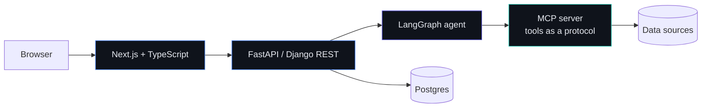

<div align="center">

# Ali Ahmadpour

**Full-stack engineer building AI systems end to end** — retrieval, agents over MCP, and the multi-tenant SaaS they sit on.

[](https://github.com/MrFox2000?tab=repositories)
[](https://github.com/MrFox2000/ai-pdf-chat)
[](https://github.com/MrFox2000/django-saas-starter)
[](https://github.com/MrFox2000/next-dashboard)
[](https://github.com/MrFox2000/next-dashboard)
[](https://github.com/MrFox2000/agentic-news-impact)
[](https://github.com/MrFox2000/agentic-news-impact)

**[Portfolio site](https://mrfox2000.github.io/portfolio-site/)** · **[All repositories](https://github.com/MrFox2000?tab=repositories)**

</div>

---

## What I actually build

I take a problem from an empty directory to something a stranger can clone, run and
believe. Every repository below has automated tests, green CI and a README that
states its own limitations — because a demo that hides its edges is not a demo.



## Selected work

| Project | What it proves | Tests |
|---|---|---|
| **[AI PDF Chat](https://github.com/MrFox2000/ai-pdf-chat)** | Retrieval over your own documents with page-level citations, streaming answers, and an offline mode so it runs with no API key | 12 |
| **[News → Price Impact](https://github.com/MrFox2000/agentic-news-impact)** | An agent whose tools are a real MCP server; LangGraph plan → collect → report, streamed live to the browser | 26 |
| **[Django SaaS Starter](https://github.com/MrFox2000/django-saas-starter)** | Multi-tenancy done properly: the tenant lives in the JWT, roles per organisation, plans with metered quotas, Stripe | 29 |
| **[SaaS Dashboard](https://github.com/MrFox2000/next-dashboard)** | The client for that API: role-aware controls, quota meter, and a `402` that becomes an upgrade prompt | — |

**63 automated tests. Zero mocked protocols.**

## The stack, and where I have used it

```text
AI          Retrieval-augmented generation, LangChain, LangGraph,
            Model Context Protocol (servers and clients), SSE streaming
Backend     Python, FastAPI, Django + DRF, PostgreSQL, JWT, Stripe,
            pytest, Docker, GitHub Actions
Frontend    TypeScript, React, Next.js App Router, Tailwind,
            and hand-written HTML/CSS/JS when the job does not need a framework
```

## How I work

1. **Agree what "done" means** before writing code, including what is out of scope.
2. **Build the smallest working slice end to end** — features come after the path works.
3. **Test what can break quietly** — auth, tenancy, quotas, parsing.
4. **Hand over something runnable** — quickstart, demo account, limitations written down.

## Currently

- Available for small, well-defined builds: an AI feature on top of your data, a SaaS backend, or fixing the multi-tenant parts of one you already have.
- Writing about the decisions behind these projects (soon).

<div align="center">

**[Portfolio](https://mrfox2000.github.io/portfolio-site/)** · **[Email](mailto:aliized1379@gmail.com)**

</div>
